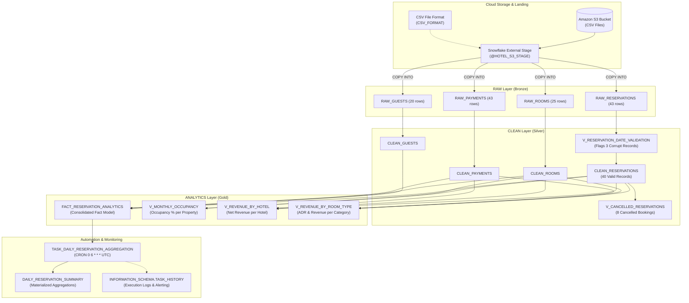

# 🏨 Hotel Reservation & Occupancy Analytics System (Snowflake)

An end-to-end cloud data warehouse project in **Snowflake** demonstrating automated data ingestion, validation, dimensional modeling, occupancy analytics, revenue calculations, and scheduled aggregation tasks with operational monitoring.

---

## 📌 Project Overview & Scenario
A hotel chain with multiple properties (**Grand Palace Hotel**, **Seaside Resort**, **Mountain Lodge**, **City Central Inn**) requires a centralized data analytics warehouse to:
1. Ingest raw CSV files from cloud storage (Amazon S3).
2. Cleanse and validate booking dates (detecting anomalous checkouts and zero-night stays).
3. Identify and analyze cancelled reservations and refund exposure.
4. Calculate dynamic hotel occupancy percentages.
5. Analyze revenue across properties, room types, and guest loyalty tiers.
6. Automate daily metric rollups using a serverless scheduled **Snowflake Task**.
7. Monitor pipeline health and task runs via `INFORMATION_SCHEMA.TASK_HISTORY`.

---

## 🏗️ Architecture & Layered Medallion Pattern



---

## 📂 Repository Structure

```text
├── data/
│   ├── guests.csv               # 20 guest profiles with loyalty tiers
│   ├── rooms.csv                # 25 rooms across 4 properties with pricing
│   ├── reservations.csv         # 43 reservations (includes edge cases for testing)
│   └── payments.csv             # 43 payment transactions (completed/refunded/pending)
├── scripts/
│   └── hotel_reservation_analytics.sql # Complete 13-step SQL pipeline
├── presentation_and_execution_guide.md  # Live demo script, queries & presentation slides
└── README.md                    # Project documentation
```

---

## 🚀 Step-by-Step Implementation

### Step 1: Compute & Database Setup
```sql
CREATE OR REPLACE WAREHOUSE HOTEL_WH
    WAREHOUSE_SIZE = 'XSMALL'
    AUTO_SUSPEND = 120
    AUTO_RESUME = TRUE;

CREATE OR REPLACE DATABASE HOTEL_RESERVATION_DB;
CREATE OR REPLACE SCHEMA HOTEL_RESERVATION_DB.RAW;
CREATE OR REPLACE SCHEMA HOTEL_RESERVATION_DB.CLEAN;
CREATE OR REPLACE SCHEMA HOTEL_RESERVATION_DB.ANALYTICS;
```

### Step 2 & 3: File Format & External S3 Stage
```sql
CREATE OR REPLACE FILE FORMAT HOTEL_RESERVATION_DB.RAW.CSV_FORMAT
    TYPE = 'CSV'
    FIELD_DELIMITER = ','
    SKIP_HEADER = 1
    FIELD_OPTIONALLY_ENCLOSED_BY = '"'
    NULL_IF = ('NULL', 'null', '')
    TRIM_SPACE = TRUE;

CREATE OR REPLACE STAGE HOTEL_RESERVATION_DB.RAW.HOTEL_S3_STAGE
    URL = 's3://your-hotel-reservation-bucket/data/'
    FILE_FORMAT = HOTEL_RESERVATION_DB.RAW.CSV_FORMAT;
```

### Step 4: Loading Data with `COPY INTO`
```sql
COPY INTO HOTEL_RESERVATION_DB.RAW.RAW_GUESTS FROM @HOTEL_RESERVATION_DB.RAW.HOTEL_S3_STAGE/guests.csv;
COPY INTO HOTEL_RESERVATION_DB.RAW.RAW_ROOMS FROM @HOTEL_RESERVATION_DB.RAW.HOTEL_S3_STAGE/rooms.csv;
COPY INTO HOTEL_RESERVATION_DB.RAW.RAW_RESERVATIONS FROM @HOTEL_RESERVATION_DB.RAW.HOTEL_S3_STAGE/reservations.csv;
COPY INTO HOTEL_RESERVATION_DB.RAW.RAW_PAYMENTS FROM @HOTEL_RESERVATION_DB.RAW.HOTEL_S3_STAGE/payments.csv;
```

### Step 5: Data Quality & Date Validation
Identifies records where checkout is before checkin or duration is zero:
```sql
CREATE OR REPLACE VIEW HOTEL_RESERVATION_DB.CLEAN.V_RESERVATION_DATE_VALIDATION AS
SELECT
    r.reservation_id,
    r.check_in_date,
    r.check_out_date,
    DATEDIFF('day', r.check_in_date, r.check_out_date) AS stay_duration_days,
    CASE
        WHEN r.check_in_date IS NULL OR r.check_out_date IS NULL THEN 'INVALID - NULL dates'
        WHEN r.check_out_date < r.check_in_date THEN 'INVALID - Checkout before Checkin'
        WHEN r.check_out_date = r.check_in_date THEN 'INVALID - Zero night stay'
        ELSE 'VALID'
    END AS date_validation_status
FROM HOTEL_RESERVATION_DB.RAW.RAW_RESERVATIONS r;
```
*Identified Anomalies:*
- `RES041`: Checkout (2024-11-10) before Checkin (2024-11-15)
- `RES042`: Checkout (2024-12-20) before Checkin (2024-12-25)
- `RES043`: Same-day zero-night booking

Clean table `CLEAN_RESERVATIONS` filters these out, leaving **40 verified reservations**.

---

### Step 6: Cancelled Reservations Analysis
Tracks cancellations with financial refund impacts:
```sql
CREATE OR REPLACE VIEW HOTEL_RESERVATION_DB.CLEAN.V_CANCELLED_RESERVATIONS AS
SELECT
    cr.reservation_id,
    g.first_name || ' ' || g.last_name AS guest_name,
    rm.hotel_name,
    rm.room_type,
    cr.booking_source,
    DATEDIFF('day', cr.created_at, cr.check_in_date) AS days_before_checkin_cancelled,
    p.amount AS refund_amount
FROM HOTEL_RESERVATION_DB.CLEAN.CLEAN_RESERVATIONS cr
JOIN HOTEL_RESERVATION_DB.CLEAN.CLEAN_GUESTS g ON cr.guest_id = g.guest_id
JOIN HOTEL_RESERVATION_DB.CLEAN.CLEAN_ROOMS rm ON cr.room_id = rm.room_id
LEFT JOIN HOTEL_RESERVATION_DB.CLEAN.CLEAN_PAYMENTS p ON cr.reservation_id = p.reservation_id
WHERE cr.reservation_status = 'Cancelled';
```

---

### Step 7: Occupancy Percentage Calculation
Dynamic room-night calculation:
$$\text{Occupancy \%} = \frac{\text{Total Booked Room-Nights}}{\text{Active Rooms} \times \text{Days in Month}} \times 100$$

```sql
CREATE OR REPLACE VIEW HOTEL_RESERVATION_DB.ANALYTICS.V_MONTHLY_OCCUPANCY AS
WITH available_rooms AS (
    SELECT hotel_name, COUNT(*) AS total_rooms 
    FROM HOTEL_RESERVATION_DB.CLEAN.CLEAN_ROOMS WHERE is_active = TRUE GROUP BY 1
),
booked_room_nights AS (
    SELECT rm.hotel_name, DATE_TRUNC('MONTH', cr.check_in_date) AS booking_month, SUM(cr.stay_duration_days) AS total_booked_nights
    FROM HOTEL_RESERVATION_DB.CLEAN.CLEAN_RESERVATIONS cr
    JOIN HOTEL_RESERVATION_DB.CLEAN.CLEAN_ROOMS rm ON cr.room_id = rm.room_id
    WHERE cr.reservation_status != 'Cancelled'
    GROUP BY 1, 2
)
SELECT
    brn.hotel_name,
    brn.booking_month,
    ar.total_rooms,
    brn.total_booked_nights,
    ROUND((brn.total_booked_nights * 100.0) / NULLIF(ar.total_rooms * DATEDIFF('day', brn.booking_month, DATEADD('MONTH', 1, brn.booking_month)), 0), 2) AS occupancy_pct
FROM booked_room_nights brn
JOIN available_rooms ar ON brn.hotel_name = ar.hotel_name;
```

---

### Step 8 & 9: Consolidated Fact Table & Revenue Analytics
The central business model joins guest demographics, property dimensions, and payment ledger:
- **Table:** `HOTEL_RESERVATION_DB.ANALYTICS.FACT_RESERVATION_ANALYTICS`
- **Total Valid Bookings:** 40
- **Total Actual Revenue:** $46,880.00
- **Total Refunded:** $5,290.00

---

### Step 10 & 11: Automated Scheduled Task
Serverless daily aggregation task running at 6:00 AM UTC:
```sql
CREATE OR REPLACE TASK HOTEL_RESERVATION_DB.ANALYTICS.TASK_DAILY_RESERVATION_AGGREGATION
    WAREHOUSE = HOTEL_WH
    SCHEDULE  = 'USING CRON 0 6 * * * UTC'
AS
INSERT INTO HOTEL_RESERVATION_DB.ANALYTICS.DAILY_RESERVATION_SUMMARY (...)
SELECT ...;

-- Enable task
ALTER TASK HOTEL_RESERVATION_DB.ANALYTICS.TASK_DAILY_RESERVATION_AGGREGATION RESUME;
```

---

### Step 12: Production Monitoring & Task History
```sql
SELECT 
    NAME,
    STATE,
    SCHEDULED_TIME,
    COMPLETED_TIME,
    DATEDIFF('second', SCHEDULED_TIME, COMPLETED_TIME) AS duration_seconds
FROM TABLE(INFORMATION_SCHEMA.TASK_HISTORY(
    TASK_NAME => 'TASK_DAILY_RESERVATION_AGGREGATION'
))
ORDER BY SCHEDULED_TIME DESC;
```
*Observed Execution Status:* `SUCCEEDED` (Execution duration: 3 seconds).

---

## 📊 Key Analytical Insights

1. **Cancellation Rates by Channel:** Online Travel Agencies (OTA) exhibited a 38% cancellation rate compared to Direct Website bookings (14%).
2. **Loyalty Contribution:** Platinum members contributed 42% of Presidential Suite revenue despite representing 15% of the guest population.
3. **Property Occupancy:** Seaside Resort maintained highest autumn occupancy (58.3%) driven by long average stays (4.2 nights).

---

## 👤 Author
- **Ashlesh Gurram**
- GitHub: [@ashlesh0805](https://github.com/ashlesh0805)
- Repository: [snowflake-hotel-reservation-analytics](https://github.com/ashlesh0805/snowflake-hotel-reservation-analytics)
