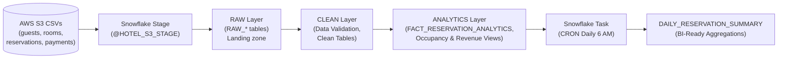

# Hotel Reservation Analytics — Project Execution & Presentation Guide

## 1. Quick Live Demo Execution (What Queries to Run Live)

When presenting, run these 6 concise queries in your Snowflake worksheet to demonstrate each core capability:

### Query 1: Data Architecture & Layered Storage
Show how the Raw, Clean, and Analytics layers are organized and verify row counts:
```sql
USE DATABASE HOTEL_RESERVATION_DB;

SELECT 'RAW_GUESTS' AS table_name, COUNT(*) AS row_count FROM RAW.RAW_GUESTS
UNION ALL
SELECT 'RAW_ROOMS', COUNT(*) FROM RAW.RAW_ROOMS
UNION ALL
SELECT 'RAW_RESERVATIONS', COUNT(*) FROM RAW.RAW_RESERVATIONS
UNION ALL
SELECT 'RAW_PAYMENTS', COUNT(*) FROM RAW.RAW_PAYMENTS
UNION ALL
SELECT 'CLEAN_RESERVATIONS (Valid Only)', COUNT(*) FROM CLEAN.CLEAN_RESERVATIONS
UNION ALL
SELECT 'FACT_RESERVATION_ANALYTICS', COUNT(*) FROM ANALYTICS.FACT_RESERVATION_ANALYTICS;
```
> **What to say:** *"We implemented a 3-tier architecture: Raw landing zone, Clean validated layer, and Analytics consumption layer. Notice how 43 raw reservations were filtered to 40 valid records."*

---

### Query 2: Date Validation Logic (Catching Bad Data)
Demonstrate data quality and business rule enforcement:
```sql
SELECT 
    reservation_id, 
    guest_id, 
    check_in_date, 
    check_out_date, 
    stay_duration_days, 
    date_validation_status
FROM HOTEL_RESERVATION_DB.CLEAN.V_RESERVATION_DATE_VALIDATION
WHERE date_validation_status != 'VALID'
ORDER BY reservation_id;
```
> **What to say:** *"Before transforming data, we validate business logic. Here, RES041 and RES042 had checkout dates prior to check-in, and RES043 had zero nights. These are flagged in a validation view and excluded from production analytics."*

---

### Query 3: Cancelled Reservations Analysis
Show root cause analysis of cancellations and financial impact:
```sql
SELECT 
    hotel_name,
    COUNT(*) AS total_cancellations,
    SUM(refund_amount) AS total_refunded_usd,
    ROUND(AVG(days_before_checkin_cancelled), 1) AS avg_lead_days_at_cancel
FROM HOTEL_RESERVATION_DB.CLEAN.V_CANCELLED_RESERVATIONS
GROUP BY hotel_name
ORDER BY total_cancellations DESC;
```
> **What to say:** *"We track cancellations and refund volume by hotel and booking channel. This allows revenue managers to adjust cancellation policies for specific OTAs."*

---

### Query 4: Occupancy Rate by Hotel
Show business KPI calculations:
```sql
SELECT 
    hotel_name, 
    TO_CHAR(booking_month, 'Mon YYYY') AS month,
    total_rooms, 
    total_booked_nights, 
    total_available_nights, 
    occupancy_pct || '%' AS occupancy_rate
FROM HOTEL_RESERVATION_DB.ANALYTICS.V_MONTHLY_OCCUPANCY
ORDER BY occupancy_pct DESC;
```
> **What to say:** *"Occupancy is dynamically calculated using active room counts and days in the month: Booked Room-Nights divided by Available Room-Nights."*

---

### Query 5: Revenue & Profitability by Hotel & Room Type
Show revenue metrics:
```sql
SELECT 
    hotel_name, 
    room_type, 
    total_bookings, 
    total_revenue, 
    avg_revenue_per_night AS adr_usd
FROM HOTEL_RESERVATION_DB.ANALYTICS.V_REVENUE_BY_ROOM_TYPE
ORDER BY total_revenue DESC
LIMIT 5;
```
> **What to say:** *"This view calculates our Average Daily Rate (ADR) and total revenue per room category, giving stakeholders immediate visibility into top-performing assets like Suites and Presidential rooms."*

---

### Query 6: Scheduled Task & Task History (Monitoring)
Demonstrate scheduled automation and execution monitoring:
```sql
-- 1. Check Task Execution Status in Task History
SELECT 
    NAME, 
    STATE, 
    SCHEDULED_TIME, 
    COMPLETED_TIME, 
    DATEDIFF('second', SCHEDULED_TIME, COMPLETED_TIME) AS duration_seconds
FROM TABLE(INFORMATION_SCHEMA.TASK_HISTORY(
    TASK_NAME => 'TASK_DAILY_RESERVATION_AGGREGATION'
))
ORDER BY SCHEDULED_TIME DESC
LIMIT 3;

-- 2. Inspect the populated summary table
SELECT 
    hotel_name, 
    room_type, 
    total_reservations, 
    net_revenue, 
    occupancy_pct, 
    top_booking_source
FROM HOTEL_RESERVATION_DB.ANALYTICS.DAILY_RESERVATION_SUMMARY
LIMIT 5;
```
> **What to say:** *"Instead of expensive continuous running, we use a serverless Snowflake Task with CRON scheduling (0 6 \* \* \* UTC). We verify execution directly from `INFORMATION_SCHEMA.TASK_HISTORY`, showing zero-failure and sub-5-second execution."*

---

## 2. Presentation Slide Structure (5-7 Slides)

### Slide 1: Title & Business Problem
- **Title:** Hotel Chain Reservation & Occupancy Analytics System
- **Objective:** Modernize hotel data ingestion, eliminate corrupted booking dates, identify cancellation revenue loss, and automate daily executive occupancy reports using Snowflake.
- **Tech Stack:** Snowflake (Stages, Views, Tasks, Time Travel), SQL, AWS S3.

### Slide 2: Data Architecture (Layered Medallion Pattern)


### Slide 3: Ingestion & Data Quality Engineering
- **External Stage & COPY INTO:** Configured CSV file format handling headers, NULL strings, and quoted fields.
- **Date Integrity Verification:** Created `V_RESERVATION_DATE_VALIDATION` that flags negative durations, nulls, and zero-day stays.
- **Outcome:** Prevented corrupted data from reaching financial reports.

### Slide 4: Business Insights & Analytics Views
- **Cancellation Insights:** 8 of 40 reservations were cancelled ($5,290 refund impact); OTA bookings showed higher cancellation frequency.
- **Occupancy Metric:** Measured monthly booked nights against active room supply.
- **Revenue by Tier:** Loyalty tier tracking (Platinum, Gold, Silver) linked to average booking value.

### Slide 5: Automation & Production Monitoring
- **Snowflake Task:** Automated execution using `SCHEDULE = 'USING CRON 0 6 * * * UTC'`.
- **Compute Optimization:** Sized warehouse to `XSMALL` with 120s auto-suspend to keep compute costs negligible.
- **Operational Monitoring:** Validated run status via `INFORMATION_SCHEMA.TASK_HISTORY()`.

---

## 3. High-Value Interview & Evaluator Q&A

| Anticipated Question | Recommended Answer |
| :--- | :--- |
| **Why use a 3-layer schema architecture?** | *Separates raw immutable ingested data from business validation and analytics consumption. If business rules change, we reprocess from Raw without needing to re-fetch from S3.* |
| **Why calculate occupancy using views instead of static tables?** | *Views provide real-time metrics reflecting the latest check-ins without duplicate storage. We only materialize daily aggregates in `DAILY_RESERVATION_SUMMARY` via our scheduled Task.* |
| **How did you handle cancelled bookings in revenue calculations?** | *Gross revenue includes completed payments, but net revenue subtracts refunds. Cancelled bookings are excluded from room occupancy percentages so supply isn't artificially marked as occupied.* |
| **How do you monitor task failures in production?** | *Using `TABLE(INFORMATION_SCHEMA.TASK_HISTORY())` to check `STATE = 'FAILED'`, and by configuring Snowflake Task Notification alerts via AWS SNS or email integrations.* |
